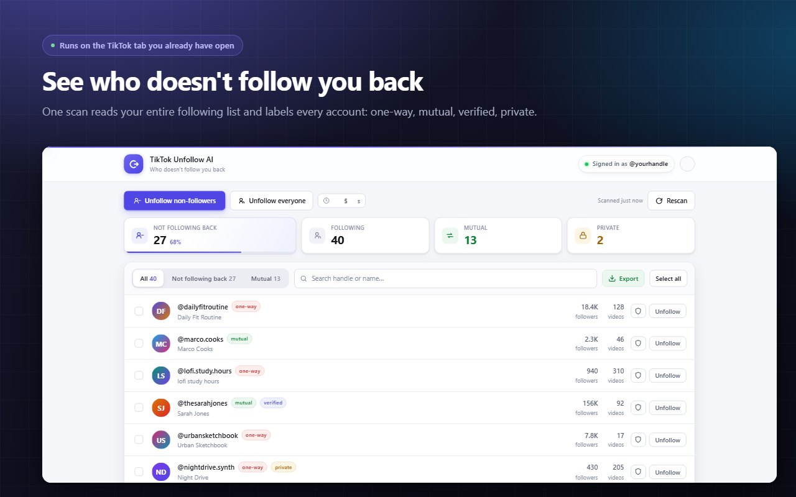
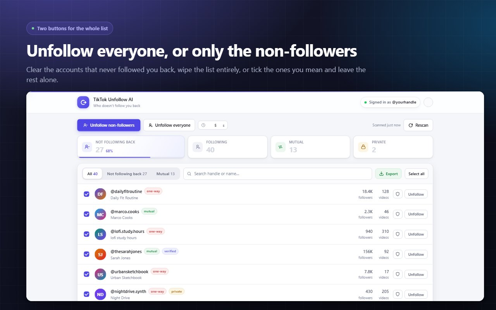
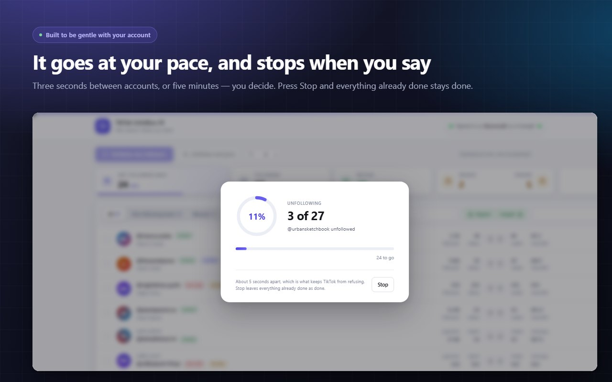

# TikTok Unfollow AI: Mass Unfollow on TikTok, Everyone or Only Non-Followers

TikTok Unfollow AI is a Chrome extension for cleaning up a TikTok following list from your computer. TikTok has no unfollow-all button: the app makes you open the list and tap accounts one at a time. The extension lists the accounts that do not follow you back and unfollows them, or everyone, at a pace you set.

**[Install from the Chrome Web Store](https://chromewebstore.google.com/detail/lmhngakknmcjifdgjkiddkhlbdgodggk?utm_source=github&utm_medium=readme&utm_campaign=tiktok_unfollow_ai)** | **[Full guide and FAQ](https://www.addonschrome.com/extensions/tiktok-unfollow-ai-mass-auto-unfollow-all-everyone-non-followers.html?utm_source=github&utm_medium=readme&utm_campaign=tiktok_unfollow_ai)** | **[Video demo](https://www.youtube.com/watch?v=oum-V4dt2e0)**

This repository is the public home for TikTok Unfollow AI documentation, release notes and the issue tracker. The extension itself is distributed through the Chrome Web Store.

## Features

- See which accounts you follow do not follow you back
- Unfollow everyone, or only the non-followers
- Protect the accounts you never want touched
- Adjustable delay between accounts, from 3 seconds to 5 minutes
- Randomised intervals instead of a fixed rhythm
- Stops on its own if TikTok refuses three times in a row
- Stop any time; finished work stays finished
- No TikTok password needed: it works in your logged-in browser session
- Works on Chrome, Edge, Brave, Opera and Vivaldi

## How to mass unfollow on TikTok

1. Install TikTok Unfollow AI from the [Chrome Web Store](https://chromewebstore.google.com/detail/lmhngakknmcjifdgjkiddkhlbdgodggk?utm_source=github&utm_medium=readme&utm_campaign=tiktok_unfollow_ai).
2. Open TikTok in your browser while logged in.
3. Open the extension and let it load your following list.
4. Choose non-followers only, or everyone, and mark the accounts to protect.
5. Set the delay and start.

The [full guide](https://www.addonschrome.com/extensions/tiktok-unfollow-ai-mass-auto-unfollow-all-everyone-non-followers.html?utm_source=github&utm_medium=readme&utm_campaign=tiktok_unfollow_ai) covers the settings and the questions people ask most.

## A straight answer: can you see who unfollowed you on TikTok?

No. TikTok does not expose unfollow events to anyone, so no tool can show a list of people who unfollowed you. What can be checked is whether each account you follow currently follows you back, and that is what the extension shows.

## Free plan and Premium

- **Free:** 25 accounts on your first day and 20 more each following day. The allowance accumulates while you are away.
- **Premium:** removes the daily limit, for very large following lists.

## Go slowly

Speed is what gets accounts restricted. Long delays and small daily batches are the safe way to clean a list.

## Screenshots

## Support and feedback

Found a bug or want a feature? [Open an issue](../../issues) in this repository. Please include your Chrome version and the steps that led to the problem.

## Disclaimer

TikTok Unfollow AI is an independent tool and is not affiliated with, endorsed by or sponsored by TikTok or ByteDance. "TikTok" is a trademark of its owner. You are responsible for using it within the TikTok rules.

---

Built and maintained by [Addons Chrome](https://www.addonschrome.com/?utm_source=github&utm_medium=readme&utm_campaign=tiktok_unfollow_ai).
